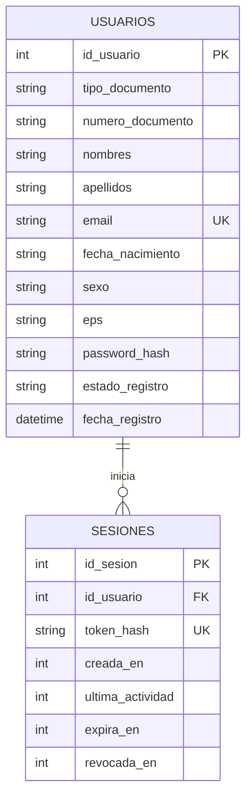

# Backend de MediTunja

Servicio Express con persistencia SQLite para registro, inicio de sesión y renovación de sesión.

## Ejecución

Requiere Node.js `>=22.9.0`.

Desde esta carpeta:

```sh
npm install
npm start
```

El servidor escucha en el puerto `3001` (o en `PORT`). La base se crea en `data/meditunja.db`; se puede cambiar su ubicación con `DB_PATH`.

## TunjaAPI y autenticación web

La aplicación web usa el proxy del backend para llamar a `POST /auth/register`, `POST /auth/login`, `POST /auth/refresh`, `POST /auth/logout` y `GET /auth/me` de TunjaAPI. El registro requiere `TUNJA_CLAVE`; nunca la pongas en una variable `VITE_` ni la envíes al navegador.

Copia `.env.example` como `.env` dentro de `backend/` y asigna la clave de proyecto. El comando `npm start` carga ese archivo. La API usa email y contraseña para iniciar sesión, y `nombre`, `documento`, `perfil` y `descuento` para el registro. La cuenta se inicia automáticamente tras registrarse.

La autenticación local SQLite descrita más abajo permanece disponible para compatibilidad con los endpoints `/api/registro` y `/api/login`; los formularios web usan exclusivamente las rutas `/api/tunja/auth/*`.

## API de autenticación

### `POST /api/registro`

JSON requerido:

```json
{
  "tipo_documento": "CC",
  "numero_documento": "1020304050",
  "nombres": "Ana María",
  "apellidos": "Pérez Gómez",
  "fecha_nacimiento": "1995-08-14",
  "sexo": "F",
  "eps": "EPS Sura",
  "email": "ana@example.com",
  "telefono": "3001234567",
  "contrasena": "una-clave-segura"
}
```

La respuesta `201` registra la solicitud con `estado_registro: "pendiente"`; un administrador debe aprobarla antes del primer inicio de sesión. El par tipo/número de documento y el correo son únicos; si ya existen se responde `409`. La contraseña se persiste únicamente como derivación `scrypt` con salt aleatorio.
Fecha de nacimiento, sexo (`M`, `F` u `O`) y EPS son campos opcionales para clientes anteriores; la aplicación web los solicita y los guarda. Al iniciar, el esquema añade esos campos a bases existentes.

### `POST /api/login`

JSON requerido:

```json
{
  "tipo_documento": "CC",
  "numero_documento": "1020304050",
  "contrasena": "una-clave-segura"
}
```

Solo cuentas `aprobado` pueden iniciar sesión. Las solicitudes `pendiente` y `rechazado` reciben mensajes específicos. El token opaco se devuelve una sola vez; en SQLite solo se guarda su SHA-256.

### `GET /api/sesion`

Requiere `Authorization: Bearer <token>`. Cada solicitud autenticada renueva la expiración a 30 minutos desde la actividad. Las rutas protegidas del API deben montarse después del middleware de sesión en `src/routes/api.js`.

### `POST /api/logout`

Requiere el mismo token Bearer. Revoca la sesión y evita que pueda volver a utilizarse.

## Aplicación web

Ejecuta el backend en `backend/` con `npm start` y, en otra terminal, el frontend en `frontend/` con `npm run dev`. Vite reenvía `/api` al backend en `http://localhost:3001`; para otra dirección, configura `VITE_API_URL` como la URL base que termina en `/api`.

## Modelo entidad-relación



La base de datos impone unicidad del documento y del correo, los estados permitidos y el formato de salt/hash; no admite almacenar la contraseña original.

## Wireframes

La validación con la PO y el registro de sus ajustes quedan pendientes de realizar con la PO; este repositorio no contiene una confirmación ni comentarios de esa revisión.
