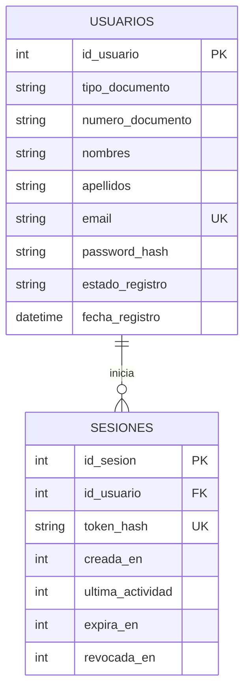

# Backend de MediTunja

Servicio Express con persistencia SQLite para registro, inicio de sesión y renovación de sesión.

## Ejecución

Desde esta carpeta:

```sh
npm install
npm start
```

El servidor escucha en el puerto `3001` (o en `PORT`). La base se crea en `data/meditunja.db`; se puede cambiar su ubicación con `DB_PATH`.

## API de autenticación

### `POST /api/registro`

JSON requerido:

```json
{
  "tipo_documento": "CC",
  "numero_documento": "1020304050",
  "nombres": "Ana María",
  "apellidos": "Pérez Gómez",
  "email": "ana@example.com",
  "telefono": "3001234567",
  "contrasena": "una-clave-segura"
}
```

La respuesta `201` registra la solicitud con `estado_registro: "pendiente"`. El par tipo/número de documento y el correo son únicos; si ya existen se responde `409`. La contraseña se persiste únicamente como derivación `scrypt` con salt aleatorio.

### `POST /api/login`

JSON requerido:

```json
{
  "tipo_documento": "CC",
  "numero_documento": "1020304050",
  "contrasena": "una-clave-segura"
}
```

Solo cuentas `aprobado` pueden iniciar sesión. Las solicitudes `pendiente` y `rechazado` reciben mensajes específicos. El token opaco se devuelve una sola vez; en SQLite solo se guarda su SHA-256.

### `GET /api/sesion`

Requiere `Authorization: Bearer <token>`. Cada solicitud autenticada renueva la expiración a 30 minutos desde la actividad. Las rutas protegidas del API deben montarse después del middleware de sesión en `src/routes/api.js`.

## Modelo entidad-relación



La base de datos impone unicidad del documento y del correo, los estados permitidos y el formato de salt/hash; no admite almacenar la contraseña original.

## Wireframes

La validación con la PO y el registro de sus ajustes quedan pendientes de realizar con la PO; este repositorio no contiene una confirmación ni comentarios de esa revisión.
